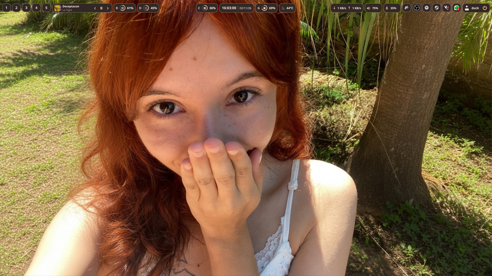
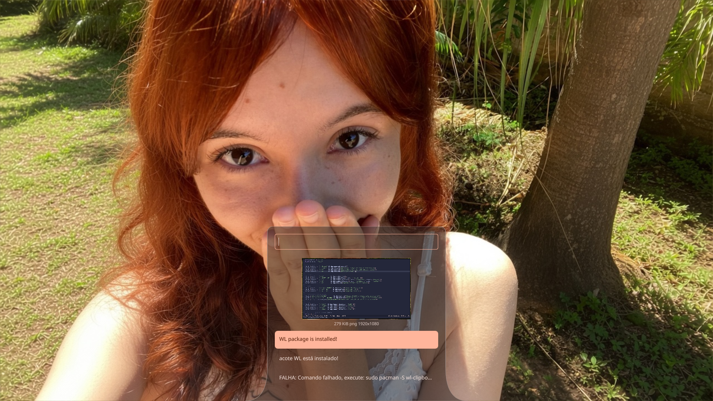
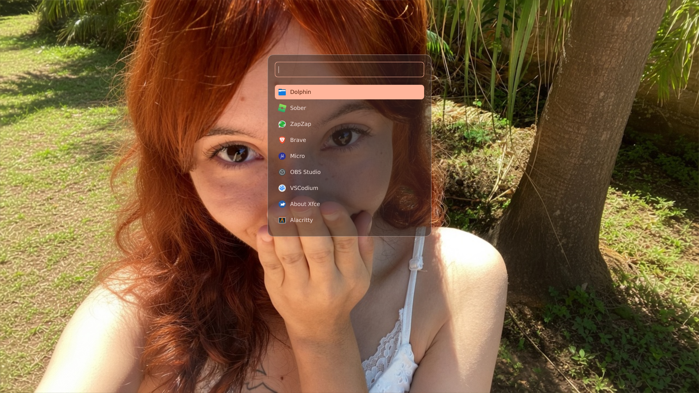

# Wayck

**A modern, modular and customizable desktop shell for Linux.**

Wayck is a Linux desktop shell built with **Rust, Quickshell and QML**, designed to provide a cohesive desktop experience through a modular, efficient and maintainable architecture.

It combines desktop controls, system monitoring and productivity tools in a unified interface.

---

## Preview

| **DESKTOP BAR** | **CLIPBOARD** | **APPLICATION LAUNCHER** |
|:---:|:---:|:---:|
| System monitoring and desktop controls | Clipboard history and management | Quick application access |
|  |  |  |

---

## Features

### Desktop Bar

A modular desktop bar combining system information, workspace management and desktop controls.

- **Workspaces:** workspace management and navigation.
- **Media:** media player information and playback controls.
- **Audio:** audio controls and volume information.
- **System Tray:** access to tray applications.
- **Clock:** desktop clock.
- **System Monitoring:** CPU, RAM, GPU, disk, network and temperature information.
- **User Menu:** user-related actions and information.

### Languages

The whole interface (bar, user menu, launcher, clipboard, notifications) and the installer are translated into **23 languages**, and the language can be changed **without restarting** Wayck. See [Languages](#languages).

### Clipboard

A dedicated interface for clipboard interaction and history management.

### Application Launcher

An integrated application launcher designed to provide quick access to installed applications.

---

## Technology Stack

| Technology | Purpose |
|:---|:---|
| [Rust](https://www.rust-lang.org/) | Backend and system operations |
| [Quickshell](https://quickshell.org/) | Desktop shell framework |
| [QML](https://doc.qt.io/qt-6/qmlapplications.html) | Interface composition and interaction |
| [Qt Quick](https://doc.qt.io/qt-6/qtquick-index.html) | UI components and rendering |
| [Cargo](https://doc.rust-lang.org/cargo/) | Dependency and build management |

## Shortcuts

| Function | Command | Shortcut | Description
|:---|:---|:---|:---|
| Wayck | qs -c wayck | Super + Shift + T | Open Wayck |
| Wayck | qs -c wayck kill | Super + T | Kill Wayck |
| Launcher | qs -c wayck ipc call launcher toggle | Super + Space | Open/Hide the Wayck Launcher |
| Clipboard | qs -c wayck ipc call clipboard toggle | Super + V |  Open/Hide the Wayck Clipboard |
| Bar | qs -c wayck ipc call bar toggle | Super + B | Active/Disable the Wayck Bar |
| Wallpaper | qs -c wayck ipc call wallpaper open | Opens the wallpapers selector |
| Screenshot Full | qs -c wayck ipc call screenshot full | Ctrl + Alt + Return | Save a full screenshot in Pictures |
| Screenshot Region | qs -c wayck ipc call screenshot region | Ctrl + Shift +  Alt + Return | Save a region screenshot in Pictures |
| Screenshot OCR | qs -c wayck ipc call screenshot regionOCR | Ctrl + Shift + Alt + S + Return | Saves a region capture that copies texts to its history |

---

## Observation

You need to have selected the "My Settings" option to have the same shortcuts.

## Architecture

Wayck keeps each interface in its own directory (`bar`, `launcher`, `clipboard`) and shared state in `singletons/`. Every type and singleton is registered once in `qml/qmldir`, so files just `import` the QML root and use things by name.

```text
wayck/
├── docs
│   ├── bar.png
│   ├── clipboard.png
│   └── launcher.png
├── hypr
│   ├── config
│   │   ├── animations.lua
│   │   ├── exec.lua
│   │   ├── keybinds.lua
│   │   ├── monitors.lua
│   │   ├── settings.lua
│   │   └── variables.lua
│   └── hyprland.lua
├── qml
│   ├── assets
│   │   ├── languages
│   │   │   ├── ar.json
│   │   │   ├── az.json
│   │   │   ├── bg.json
│   │   │   ├── de.json
│   │   │   ├── en.json
│   │   │   ├── es.json
│   │   │   ├── fa.json
│   │   │   ├── fr.json
│   │   │   ├── hi.json
│   │   │   ├── hy.json
│   │   │   ├── id.json
│   │   │   ├── it.json
│   │   │   ├── ja.json
│   │   │   ├── ko.json
│   │   │   ├── nl.json
│   │   │   ├── pl.json
│   │   │   ├── pt.json
│   │   │   ├── ru.json
│   │   │   ├── tr.json
│   │   │   ├── ua.json
│   │   │   ├── vi.json
│   │   │   ├── zh.json
│   │   │   └── zh_tw.json
│   │   ├── matugen
│   │   │   └── colors.json.template
│   │   ├── shaders
│   │   │   ├── hold_wave.frag
│   │   │   └── hold_wave.frag.qsb
│   │   └── sounds
│   │       ├── guide
│   │       │   └── barconfig
│   │       │       ├── in.wav
│   │       │       └── out.wav
│   │       ├── musicpopup
│   │       │   └── swoosh.wav
│   │       ├── network
│   │       │   ├── connect.wav
│   │       │   ├── disconnect.wav
│   │       │   ├── power_off.wav
│   │       │   ├── power_on.wav
│   │       │   └── switch.wav
│   │       ├── notifications
│   │       │   ├── Botanica.wav
│   │       │   ├── Curious.mp3
│   │       │   ├── Progress.wav
│   │       │   ├── Sine.wav
│   │       │   ├── Sneak.mp3
│   │       │   ├── WakeUp.mp3
│   │       │   └── Wobbly.mp3
│   │       ├── quickactions
│   │       │   └── usage.wav
│   │       ├── reusables
│   │       │   ├── clickbutton
│   │       │   │   ├── click2.wav
│   │       │   │   └── click.wav
│   │       │   ├── draggable
│   │       │   │   └── tick.wav
│   │       │   ├── dropdown
│   │       │   │   ├── click.wav
│   │       │   │   └── list.wav
│   │       │   ├── fillbutton
│   │       │   │   ├── button.wav
│   │       │   │   ├── charge_loop2.wav
│   │       │   │   └── charge_loop.wav
│   │       │   ├── iconbutton
│   │       │   │   └── click.wav
│   │       │   ├── input
│   │       │   │   └── type.wav
│   │       │   ├── switch
│   │       │   │   └── sfx.wav
│   │       │   └── toggle
│   │       │       └── sfx.wav
│   │       ├── start
│   │       │   ├── background.wav
│   │       │   ├── exit.wav
│   │       │   ├── pop_author.wav
│   │       │   ├── start.wav
│   │       │   ├── transition_serp.wav
│   │       │   ├── type.wav
│   │       │   └── wave.wav
│   │       ├── system
│   │       │   └── quick_click.wav
│   │       └── tutorial
│   │           ├── tip_guide.wav
│   │           └── tip.wav
│   ├── bar
│   │   ├── faces
│   │   │   ├── audio
│   │   │   │   └── AudioFace.qml
│   │   │   ├── clock
│   │   │   │   └── ClockFace.qml
│   │   │   ├── cpu
│   │   │   │   └── CpuFace.qml
│   │   │   ├── disk
│   │   │   │   └── DiskFace.qml
│   │   │   ├── gpu
│   │   │   │   └── GpuFace.qml
│   │   │   ├── network
│   │   │   │   └── NetworkFace.qml
│   │   │   ├── player
│   │   │   │   └── PlayerFace.qml
│   │   │   ├── ram
│   │   │   │   └── RamFace.qml
│   │   │   ├── temperature
│   │   │   │   └── TemperatureFace.qml
│   │   │   ├── tray
│   │   │   │   ├── qmldir
│   │   │   │   ├── TrayFace.qml
│   │   │   │   ├── TrayItem.qml
│   │   │   │   └── TrayMenu.qml
│   │   │   ├── updater
│   │   │   │   └── UpdaterFace.qml
│   │   │   ├── usermenu
│   │   │   │   └── UserMenuFace.qml
│   │   │   └── workspaces
│   │   │       └── WorkspacesFace.qml
│   │   ├── BarConfig.qml
│   │   ├── BarModule.qml
│   │   ├── BarModuleRegistry.qml
│   │   ├── Bar.qml
│   │   ├── BarSection.qml
│   │   └── qmldir
│   ├── clipboard
│   │   └── Clipboard.qml
│   ├── launcher
│   │   └── Launcher.qml
│   ├── notifications
│   │   ├── NotificationCard.qml
│   │   └── NotificationPopup.qml
│   ├── reusables
│   │   ├── BarCard.qml
│   │   ├── Morph.qml
│   │   └── WaveFill.qml
│   ├── singletons
│   │   ├── audio
│   │   │   └── MprisController.qml
│   │   ├── info
│   │   │   └── SysData.qml
│   │   ├── system
│   │   │   ├── Config.qml
│   │   │   ├── I18n.qml
│   │   │   ├── NotificationController.qml
│   │   │   ├── SoundController.qml
│   │   │   ├── SysNotif.qml
│   │   │   ├── UpdateController.qml
│   │   │   └── WallpaperService.qml
│   │   ├── theme
│   │   │   ├── Motion.qml
│   │   │   └── Theme.qml
│   │   └── widgetcontrols
│   │       ├── BarController.qml
│   │       ├── ClipboardController.qml
│   │       ├── LanguageController.qml
│   │       ├── LauncherController.qml
│   │       ├── ScreenshotController.qml
│   │       ├── TrayController.qml
│   │       └── UserController.qml
│   ├── wallpaper
│   │   ├── WallpaperEngine.qml
│   │   └── WallpaperSelector.qml
│   ├── qmldir
│   └── shell.qml
├── scripts
│   ├── i18n-check.sh
│   └── wayck-wallpaper.sh
├── src
│   ├── clipboard.rs
│   ├── launcher.rs
│   ├── main.rs
│   ├── monitor.rs
│   ├── update.rs
│   └── utils.rs
├── Cargo.lock
├── Cargo.toml
├── CHANGELOG.md
├── .gitignore
├── install.sh
├── README.md
└── version.txt
```

### Design Principles

- **Feature isolation:** each interface has its own dedicated directory.
- **Centralized state:** shared functionality lives in `singletons/`, with one controller per widget.
- **Modularity:** each bar module is a self-contained face in `bar/faces/`.
- **Separation of concerns:** QML handles presentation and interaction, while Rust handles backend operations.
- **Single source of truth:** colors live in `Theme`, settings in `Config`, texts in `qml/assets/languages/*.json` (via `I18n`), and the list of bar modules in `BarModuleRegistry`.
- **Maintainability:** a consistent structure avoids unnecessary directory fragmentation.

---

## Requirements

- Linux
- Rust and Cargo
- Quickshell
- Qt dependencies required by Quickshell
- Hyprland for Hyprland-specific integrations

## Installation

### Direct Installation

If you prefer to install Wayck directly, follow these steps.

**Execute this command**

```bash
bash -c "$(curl -fsSL https://raw.githubusercontent.com/DuckCosmos/wayck/main/install.sh)"
```

### Manual Installation

But, if you prefer to install Wayck manually, follow these steps.

**1. Clone the repository**

```bash
git clone https://github.com/DuckCosmos/wayck.git
cd wayck
```

**2. Build the Rust backend**

```bash
cargo build --release --bins
```

**3. Create the Quickshell configuration directory**

```bash
mkdir -p ~/.config/quickshell/wayck
```

**4. Copy the QML configuration**

```bash
cp -r qml/* ~/.config/quickshell/wayck/
```

**5. Install the backend binaries**

Install the generated binaries in the location expected by the project's QML singletons and scripts. Check `install.sh` for the exact deployment paths.

**6. Start Wayck**

```bash
quickshell -c wayck
```

---

## Building from Source

Check all Rust binaries:

```bash
cargo check --bins
```

Build all binaries in release mode:

```bash
cargo build --release --bins
```

Run the project build script:

```bash
chmod +x build.sh
./build.sh
```

## Running

After installation, start Wayck with:

```bash
quickshell -c wayck
```

The installed Quickshell configuration is expected at:

```text
~/.config/quickshell/wayck
```

## Configuration

All settings live in a single file, `~/.config/wayck/config.json`. It is created on first run, missing keys fall back to defaults, and Wayck reloads it when it changes.

```json
{
  "blur": false,
  "language": "auto",
  "bar": {
    "position": "top",
    "height": 45,
    "margin": 8,
    "layout": {
      "left": ["workspaces", "player", "ram", "disk"],
      "center": ["cpu", "clock", "gpu", "temperature"],
      "right": ["network", "audio", "tray", "usermenu"]
    }
  }
}
```

| Key | Description |
|:---|:---|
| `blur` | Enables blur on the launcher (Hyprland). |
| `language` | `"auto"` (follows the system locale) or a language code such as `"pt"`, `"ja"`, `"zh_tw"`. Changes the interface instantly. |
| `bar.position` | `"top"` or `"bottom"`. |
| `bar.height` / `bar.margin` | Bar height and side margin, in pixels. |
| `bar.layout` | Modules of each section, in order. Available ids are listed in `bar/BarModuleRegistry.qml`. |

**Responsive bar:** when there is spare room the modules spread out; when space runs short they become compact, and if that is still not enough the lowest-priority modules are hidden until there is room again. Priorities are defined in `bar/BarModuleRegistry.qml`.

**Colors** come from the matugen palette (`~/.local/state/quickshell/user/generated/colors.json`) through `qml/singletons/theme/Theme.qml`, and update live when the wallpaper changes.

## Project Structure

| Directory | Responsibility |
|:---|:---|
| `src/` | Rust backend |
| `qml/` | QML application |
| `qml/bar/` | Desktop bar (`Bar`, `BarModule`, `BarSection`, module registry) |
| `qml/bar/faces/` | One folder per bar module |
| `qml/assets/languages/` | Translation files (`<code>.json`) |
| `qml/clipboard/` | Clipboard interface |
| `qml/launcher/` | Application launcher |
| `qml/notifications/` | Notification components |
| `qml/reusables/` | Shared components (`BarCard`) |
| `qml/singletons/` | Shared singletons: `Config`, `Theme`, controllers and data |
| `scripts/` | Maintenance scripts (`i18n-check.sh`) |
| `hypr/` | Hyprland configuration |
| `docs/` | Documentation and screenshots |

## Development

Wayck is organized to allow independent development of its interface features and backend.

| Component | Location |
|:---|:---|
| Main entry point | `qml/shell.qml` |
| Type and singleton registry | `qml/qmldir` |
| Settings | `qml/singletons/system/Config.qml` |
| Colors | `qml/singletons/theme/Theme.qml` |
| Translations | `qml/singletons/system/I18n.qml` and `qml/assets/languages/` |
| Desktop Bar | `qml/bar/` |
| Bar module catalog | `qml/bar/BarModuleRegistry.qml` |
| Bar modules | `qml/bar/faces/` |
| Clipboard | `qml/clipboard/` |
| Launcher | `qml/launcher/` |
| Widget controllers (IPC) | `qml/singletons/widgetcontrols/` |
| Rust backend | `src/` |

### Adding a Bar Module

1. Create `qml/bar/faces/<id>/<Name>Face.qml`.
2. Add one entry to `types` in `qml/bar/BarModuleRegistry.qml` (name, face path, priority).
3. Put the id in `bar.layout` in `~/.config/wayck/config.json`.

### Languages

Wayck ships with 23 languages: `ar az bg de en es fa fr hi hy id it ja ko nl pl pt ru tr ua vi zh zh_tw`. Each one is a JSON file in `qml/assets/languages/`, with the same structure as `en.json` (the base language). A missing key falls back to English, and if it is missing there too the key itself is shown.

**Choosing the language** (all of these update the interface immediately, no restart):

```bash
# 1. IPC
quickshell -c wayck ipc call language set pt      # change and save
quickshell -c wayck ipc call language set auto    # follow the system language again
quickshell -c wayck ipc call language get
quickshell -c wayck ipc call language list

# 2. Edit "language" in ~/.config/wayck/config.json (Wayck reloads it by itself)

# 3. From QML (e.g. a future settings screen)
#    I18n.setLanguage("ja"); I18n.languages -> [{ code, name }, ...]
```

**Using texts in QML** — components only know the key, never the text:

```qml
import "../"   // the QML root, where I18n is registered

Text { text: I18n.t("launcher.search") }
Text { text: I18n.t("launch.notInstalled", { name: "Firefox" }) }   // "{name}" in the JSON
Text { text: I18n.t("some.key", "fallback text") }
```

`I18n` also exposes `activeLang`, `rtl`, `layoutDirection` and `horizontalAlignment` (Arabic and Persian mirror the layout of the launcher, clipboard, tray menu and user menu).

**Adding a new text:** put the key in `en.json` (and in the other languages when you have the translation), then run `./scripts/i18n-check.sh` to see what is missing.

**Adding a language:** copy `en.json` to `qml/assets/languages/<code>.json`, translate it, and add one line to `languages` in `qml/singletons/system/I18n.qml`.

**Installer:** it reads the `installer.*` keys from the same JSON files. It follows your system language, or use `--lang`:

```bash
bash install.sh --lang ja
bash -c "$(curl -fsSL https://raw.githubusercontent.com/DuckCosmos/wayck/main/install.sh)" _ --lang ja
```

When `--lang` (or `WAYCK_LANG`) is given, the choice is also saved as `language` in `config.json`.

### Development Commands

```bash
# Check Rust binaries
cargo check --bins

# Build in release mode
cargo build --release --bins

# Run the build script
./build.sh

# Check the translation files against en.json
./scripts/i18n-check.sh
```

## Contributing

Contributions, bug reports and suggestions are welcome.

When contributing, please follow the existing architecture:

- Keep feature-specific components inside their respective directories.
- Place shared functionality in `qml/singletons/` and register it in `qml/qmldir`.
- Avoid duplicated controllers and unnecessary abstractions.
- Keep backend responsibilities separate from interface presentation.
- Maintain consistent naming and organization.
- Never hardcode user-facing text in QML: use `I18n.t("key")` and add the key to `en.json`.
- Test changes before submitting contributions.

## License

See the repository for licensing information.

---

**Wayck** — Built with Rust, Quickshell and QML.